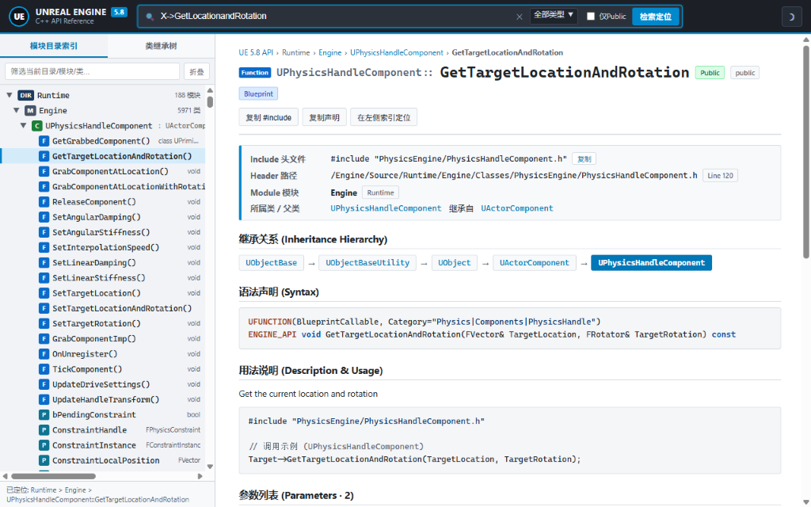
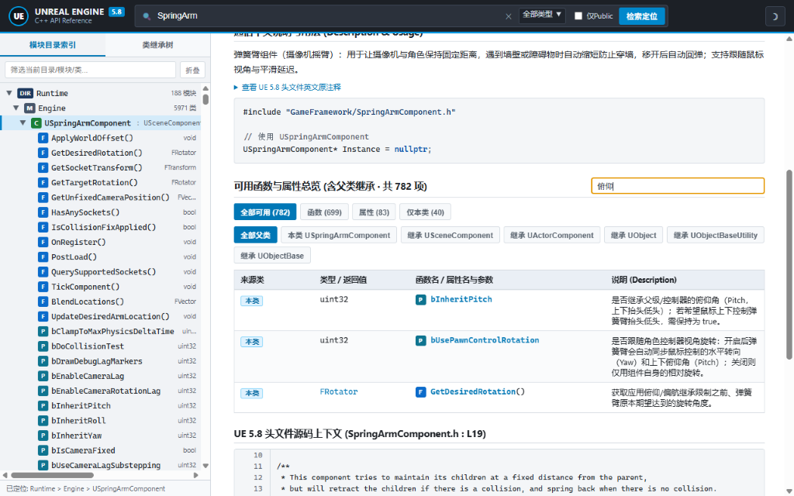
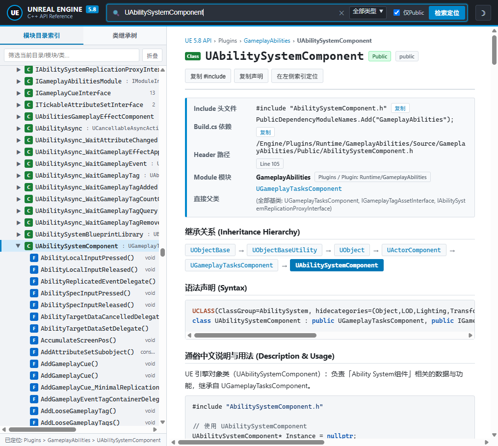

<div align="center">

# UnrealSeek

**告别卡顿的虚幻官网 —— 经典 UE4 风格、毫秒级本地离线 Unreal Engine C++ API 智能速查文档**

*Fast, Offline Unreal Engine 5 (UE 5.8+) C++ API Documentation with Classic UE4 Dual-Pane UI, Code-Line Fuzzy Matching & Chinese Semantic Search*

[](https://www.unrealengine.com/)
[](https://www.python.org/)
[](https://www.sqlite.org/fts5.html)
[](#)
[](LICENSE)

</div>

---

> **直接解析你本机安装的 UE 引擎与全部插件 `.h` 源码 + `*.Build.cs` 构建规则**，1 分钟建立全量本地 SQLite + FTS5 索引库（UE 5.8 实测覆盖 **45,233 个头文件 / 2,230 个模块 / 1,037,030 个 API 符号**）。无需联网、无需翻墙、永不 404，还原大家最怀念的 **经典 UE 4.7 双栏接口文档** 体验！



---

## 为什么做 UnrealSeek？（对比 UE 官网文档）

| 体验对比 | Epic 官方在线文档 | **UnrealSeek（本地离线）** |
| :--- | :--- | :--- |
| **打开与检索速度** | 海外站点加载慢、动辄转圈数秒 | **本地纯离线，毫秒级（10~80ms）出结果** |
| **粘贴一行 C++ 代码查函数** | 不支持（带 `X->` / 参数 / 大小写错直接无结果） | **原生支持**，如 `X->GetLocationandRotation`、`PC->GetPlayerViewPoint(Loc, Rot);` 自动拆词推断 |
| **中文自然语言检索** | 不支持 | **支持简繁体与中英混合**，如 `设置时间令牌`、`设置角色的local旋转与location` |
| **组件可用函数（含父类）** | 仅列当前类，查 `SetRelativeLocationAndRotation` 需手动一层层翻父类 | **一键总览本类 + 全部父类继承函数/属性**，支持表内中英文秒筛 |
| **`#include` 与 `Build.cs` 依赖** | 无 `Build.cs` 复制提示，且易翻到废弃页 | **严格按 2,230 个 `*.Build.cs` 校验公开头文件**，自动附带 `PublicDependencyModuleNames` |
| **界面与导航定位** | 新版留白巨大、层级难定位 | **经典 UE 4.7 高密度双栏布局**，搜索后左侧模块树/类继承树**自动展开滚动高亮定位** |

---

## 核心亮点展示

### 1. 代码行粘贴智能模糊检索（支持大小写错误、拼写容错与对象类推断）
写 UE C++ 时忘了准确函数名？直接把编辑器里的代码行粘进顶部搜索框即可：
- **`X->GetLocationandRotation`** → 自动剥离任意对象前缀并断词 `get / location / and / rotation`，精准命中 `GetTargetLocationAndRotation`、`GetSocketWorldLocationAndRotation`、`GetStreamingSourceLocationAndRotation`
- **`PC->GetPlayerViewPoint(Loc, Rot);`** → 自动推断 `PC` 对应 `APlayerController` 并匹配 2 参数重载
- **`GetActorLocatoin`** / **`X->SetActorLocAndRot`** → 拼写错误与缩写子序列容错，直达 `AActor::GetActorLocation` / `SetActorLocationAndRotation`
- **`SpringArm`** / **`Camera`** / **`CharacterMovement`** → 自动识别 UE `U/A/F` 前缀与 `*Component` 后缀，优先定位核心组件类而非插件杂项属性

### 2. 中文自然语言检索 + 全站通俗中文功能说明
不知道英文函数名也能秒查！内置 UE 专业双语词库与通俗中文说明引擎（同时保留可折叠的 **UE 原版英文注释**）：
- 搜 **`设置时间令牌`** / **`設置一个时间令牌`** → 直接定位 `FTimerManager::SetTimer`、`FTimerHandle`、`FTimerManager`
- 搜 **`设置角色的local旋转与location`** → 定位 `USceneComponent::SetRelativeLocationAndRotation`、`AActor::SetActorLocationAndRotation`、`AActor::SetActorRelativeRotation`
- 搜 **`弹簧臂俯仰角跟随鼠标`**、**`摄像机平滑延迟`**、**`射线检测`**、**`挂载组件`** → 秒出对应函数与属性

### 3. 组件“本类 + 全部父类继承”可用成员总览（支持表内中文秒筛）
打开 `USpringArmComponent` 等任意组件，页面直接汇总 **本类声明 + 继承自 `USceneComponent` / `UActorComponent` / `UObject` 的全部可用函数与属性**（共 782 项），在表内输入中文 `俯仰`、`延迟`、`防穿墙` 或英文 `SetRelativeLocationAndRotation` 即可瞬间过滤：



### 4. 严格按 `*.Build.cs`（UBT）校验官方头文件 + 自动提示模块依赖
- 自动扫描引擎全部 **2,230+ 个 `*.Build.cs`**，还原真实公开 `#include` 路径。
- 自动跳过 `#if !CPP` 的 UHT 假头文件（彻底杜绝 `FVector` / `FRotator` / `FTransform` 误指 `NoExportTypes.h`），并正确展开 UE 5.8 LWC 数学别名与 `.h.inl` 容器（`FString`、`TMap`、`TSet`）。
- 默认开启 **`仅Public`** 过滤，绝不把外部项目不可引用的引擎 `Private/Internal` 内部文件当成 `#include` 误导开发者。
- 涉及 `EnhancedInput`、`UMG`、`Niagara`、`GameplayAbilities`、`AIModule` 等非默认模块时，自动显示并支持一键复制 `PublicDependencyModuleNames.Add("...");`：



### 5. 左侧双模式索引树 + 经典浅色 / 暗黑主题
- **模块目录索引**：`Runtime / Plugins / Editor / Developer / Programs → Module → Class (: Parent) → Members & 继承自父类`
- **类继承树**：完整还原 `UObjectBase → UObjectBaseUtility → UObject → AActor → ...` 继承谱系，搜索后两种模式均支持自动逐级展开定位。
- 支持一键复制 `#include`、复制声明、参数/返回值 UE 类型点击跳转、UE 原始头文件源码上下文高亮预览，以及经典浅色 / 暗黑主题切换。

---

## 60 秒极速上手

> **环境要求**：Python 3.10+（内置 `sqlite3` 支持 FTS5），本机已安装 Unreal Engine（支持 **UE 5.8** 及任意 **UE 5.x** 引擎目录）。

### 第 1 步：克隆仓库并安装依赖
```bash
git clone https://github.com/BibabuWai-0320/UnrealSeek.git
cd UnrealSeek
pip install -r requirements.txt
```

### 第 2 步：从本机 UE 源码一键构建离线索引库（约 1 分钟）
> 说明：索引库 `data/ue58_api.db` 体积约 900 MB（且源自本地引擎源码），因此不随 Git 仓库分发；使用多进程解析器在本地 30~90 秒即可全量构建完成。

```bash
python -m indexer.build_db --engine "D:\Epic Games\UE_5.8\Engine" --workers 20
```
*(请将 `--engine` 参数替换为你的 UE `Engine` 目录实际路径，如 `C:\Program Files\Epic Games\UE_5.6\Engine`。)*

### 第 3 步：启动文档网站
- **Windows**：直接双击根目录的 **`start.bat`**（会自动等待端口就绪后弹出浏览器）
- **命令行 / macOS / Linux**：
  ```bash
  python -m server.app --open-browser
  ```
启动后在浏览器访问：**`http://127.0.0.1:5858`**（按 `/` 键可随时聚焦搜索框）。

---

## 项目架构

```text
UnrealSeek/
├── indexer/                   # 多进程 UE C++ 头文件解析与建库引擎
│   ├── build_cs.py            # 扫描全部 *.Build.cs，按 UBT 规则计算模块与公开 #include 路径
│   ├── cpp_parser.py          # 单遍词法解析器（支持跳过 #if !CPP、处理 UCLASS/UFUNCTION/UPROPERTY）
│   ├── cpp_decl.py            # 函数签名、参数列表、默认值、属性与枚举声明提取
│   ├── core_aliases.py        # 展开 UE 5.8 LWC 数学类型别名及 FString/TMap/TSet .h.inl 容器
│   ├── header_meta.py         # Doxygen 注释解析与驼峰标识符分词
│   └── build_db.py            # 多进程写入 SQLite + B-Tree + FTS5 分词/Trigram 索引
├── server/                    # 本地检索引擎与 Flask Web 服务
│   ├── code_query.py          # C++ 代码行解析器、UE 变量对象类推断、简繁中文意图映射
│   ├── fuzzy_search.py        # 多路候选召回（精确/UE前缀/Trigram/FTS5/缩写/拼写容错）+ 重排
│   ├── zh_curated.py          # 高频核心 UE API 精选通俗中文说明手册
│   ├── zh_glossary.py         # 中英双向 UE 专业术语与参数/返回值词库
│   ├── zh_translator.py       # 零延迟离线通俗中文说明生成引擎
│   ├── db_queries.py          # 目录树、类继承树、自动定位路径、父类继承成员与源码预览查询
│   └── app.py                 # Flask API 与静态页面服务
├── web/                       # 无构建依赖的轻量原生前端（经典 UE 4.7 双栏风）
│   ├── index.html
│   ├── styles.css
│   ├── search.js
│   ├── tree.js
│   └── detail.js
├── docs/images/               # README 演示截图
├── start.bat                  # Windows 一键启动脚本
├── requirements.txt
└── LICENSE                    # MIT License
```

---

## 常见问题（FAQ）

- **Q：支持 UE 5.3 / 5.4 / 5.5 / 5.6 / 5.7 吗？**
  A：完全支持！只需在 `build_db` 时把 `--engine` 指向对应版本的 `Engine` 目录即可重新生成对应版本的离线 API 文档库。
- **Q：可以把我自己的 UE 游戏项目 `Source` 代码也索引进去吗？**
  A：后续计划支持 `--extra-dirs` 参数，将团队自有游戏/插件 C++ API 一并纳入本地速查。
- **Q：觉得好用怎么支持？**
  A：如果 UnrealSeek 帮你省下了大量翻官网和查头文件的时间，欢迎点个 **Star ⭐**，也欢迎提交 PR 扩充 `server/zh_curated.py` 和 `server/zh_glossary.py` 中的中文术语与高频 API 手册！

---

## License

本项目采用 [MIT License](LICENSE) 开源。索引数据由用户从本机合法安装的 Unreal Engine 源码实时生成，不包含任何 Epic Games 专有源码文件。
